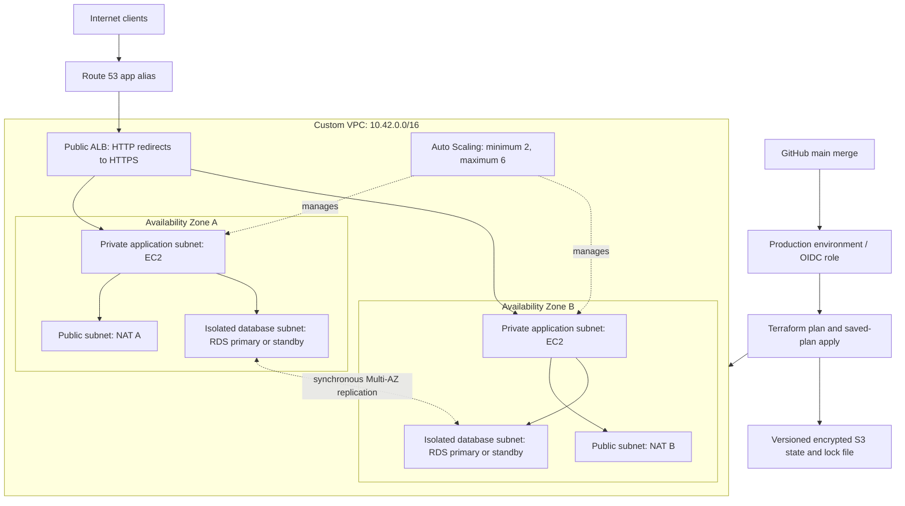

# Scalable AWS Infrastructure as Code

A reviewable Terraform project for a highly available AWS service. It provisions a custom VPC, six subnets across two Availability Zones, an HTTPS Application Load Balancer, private EC2 Auto Scaling, and an isolated Multi-AZ PostgreSQL database. GitHub Actions validates pull requests and plans/applies the merged revision through OIDC.

**History disclosure:** the initial Git history is a retrospective reconstruction dated August 27–October 27, 2026, organized into development milestones every two or three days. These timestamps illustrate a development sequence; they do not record when the work actually occurred. See [the history record](docs/HISTORY.md).

**Status:** implementation and local verification are described in [VALIDATION.md](docs/VALIDATION.md). No AWS resources have been deployed by this repository build. You must supply an AWS account, domain, ACM certificate, and GitHub environment before deployment.

## Architecture



The ALB occupies both public subnets. Each application subnet routes outbound traffic through its own AZ's NAT gateway. Database subnets have no internet/NAT route. Security groups allow ALB → app TCP 8080 and app → database TCP 5432. Public ingress is limited to ALB TCP 80/443.

## What is included

| Area | Implementation |
| --- | --- |
| Network | DNS-enabled VPC, six /24 subnets, explicit route tables, two NAT gateways, VPC flow logs |
| Edge | Route 53 alias, existing ACM certificate, TLS 1.2/1.3, HTTP redirect, S3 access logs |
| Compute | AL2023 x86_64, encrypted gp3 root disks, IMDSv2, SSM, hardened systemd service, no SSH |
| Availability | Two AZs, minimum two instances, ELB health checks, CPU target tracking, rolling refresh |
| Data | PostgreSQL 17, Multi-AZ, encryption, forced SSL, managed master secret, 14-day backups, final snapshot |
| Operations | CloudWatch logs and alarms, optional SNS email subscription, rollout wait and HTTPS smoke test |
| Delivery | SHA-pinned actions, PR checks without AWS credentials, serialized saved-plan applies on main |
| State | Separate bootstrap, private encrypted versioned S3, native S3 state locking |

The included Python application is a **small infrastructure demonstration**, not a production business application. It exposes `/` and `/healthz` on port 8080 and reports its hostname so that multiple backends can be observed. It does not query PostgreSQL. The instance role intentionally has no database-secret read access. See [architecture decisions](docs/ARCHITECTURE.md) before integrating a real application.

## Start here

The [delivery plan and release checklist](docs/PROJECT_PLAN.md) track the completed groundwork and remaining live acceptance work.

1. Read [deployment setup](docs/DEPLOYMENT.md), including the costs and account prerequisites.
2. Bootstrap the state bucket and GitHub deployment role using a local AWS SSO session.
3. Configure the GitHub `production` environment and protect `main`.
4. Run the documented local checks, review the first real AWS plan, and deploy.
5. Use the [operations runbook](docs/OPERATIONS.md) for health checks, rollback, recovery and teardown.

See the [configuration reference](docs/CONFIGURATION.md) for every input/output, version updates, and requirements for additional environments.

Do not merge the initial configuration until the environment and branch restrictions exist. A merge to `main` triggers deployment automatically. Optional environment reviewers add an approval before the deployment job starts; the default workflow does not pause between its real plan and apply.

## Repository map

```text
bootstrap/                    State bucket and repository-bound OIDC deployment role
infra/                        Production root, DNS, monitoring, variables and outputs
  modules/network/            VPC, subnets, routes and per-AZ NAT
  modules/service/            ALB, launch template, ASG, IAM and access logging
  modules/database/           Private Multi-AZ RDS and managed master credentials
  tests/                      Root architecture tests
app/server.py                 Dependency-free demo HTTP service
tests/                        Real local HTTP contract tests
scripts/                      Rollout wait and deployed HTTPS smoke check
.github/workflows/            PR validation and main deployment
docs/                         Setup, design, security, operations and verification
```

Terraform 1.13.5 is fixed in CI and `.terraform-version`; AWS provider selections are committed in lock files. Upgrade them deliberately through a pull request. No third-party Terraform modules are required.

## Local checks

Requires Terraform 1.13.x, Python 3.12+, and Bash for shell syntax checks. No AWS credentials are needed for mocked tests.

```bash
terraform fmt -check -recursive
terraform -chdir=bootstrap init -backend=false -lockfile=readonly
terraform -chdir=bootstrap validate
terraform -chdir=bootstrap test
terraform -chdir=infra init -backend=false -lockfile=readonly
terraform -chdir=infra validate
terraform -chdir=infra test
python -m unittest discover -s tests -v
bash -n scripts/wait-for-refresh.sh infra/modules/service/user-data.sh.tftpl
bash tests/rollout.sh
```

These validate configuration and architecture contracts. They do not prove AWS quotas, IAM authorization, regional engine availability, package installation, real failover, or live TLS/DNS. The deployment guide includes those acceptance checks.

## Production boundaries

This is a single-region reference deployment. Multi-AZ protects against many AZ failures; it does not provide regional disaster recovery. NAT gateways, ALB, EC2, Multi-AZ RDS, public IPv4 addresses, logging and storage incur charges while running. Consult [cost and reliability considerations](docs/ARCHITECTURE.md). It is not a free-tier stack.

Read [SECURITY.md](docs/SECURITY.md) for the deployment role's broad service permissions and the controls needed for a dedicated workload account. Application authentication, WAF, a baked application AMI, DB schema/users/migrations, organization CloudTrail, budgets and cross-region backups remain explicit integration work.
